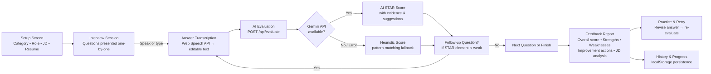
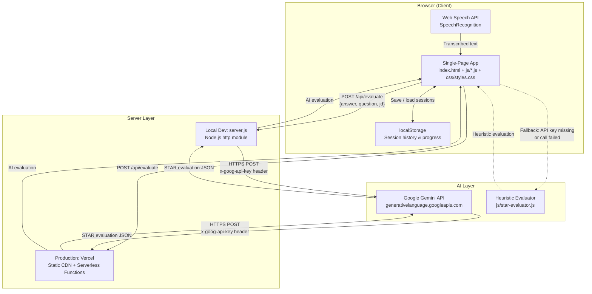

# Voxora

**Practise interviews. Get AI feedback. Land the offer.**

---

## Table of Contents

- [About the Project](#about-the-project)
- [Key Features](#key-features)
- [How It Works](#how-it-works)
- [Technology Stack](#technology-stack)
- [System Architecture](#system-architecture)
- [Getting Started](#getting-started)
- [Environment Variables](#environment-variables)
- [Deployment](#deployment)
- [Hackathon Project Goals / Future Improvements](#hackathon-project-goals--future-improvements)
- [Team](#team)
- [License](#license)

---

## About the Project

Job interviews are one of the highest-stakes conversations a person will ever have, yet most candidates prepare by rehearsing alone in front of a mirror or reading generic advice online. This approach rarely surfaces the specific weaknesses in an answer — missing context, vague actions, absent results — that real interviewers notice instantly.

**Voxora** solves this problem. It is a browser-based mock interview platform that lets job seekers and students practise answering real interview questions across six categories, transcribe their spoken answers in real time, and receive structured AI-powered feedback using the STAR method (Situation, Task, Action, Result).

Unlike practising alone, Voxora provides:

- **Objective scoring** on a transparent 100-point rubric, not vague encouragement.
- **Evidence-based feedback** — the AI cites exact quotes from the answer to justify each score.
- **Actionable improvement tips** and follow-up questions that probe weak areas.
- **Progress tracking** across sessions, so candidates can see whether they are improving.

No login is required. No data leaves the browser except the answer text sent to the Gemini API for evaluation.

---

## Key Features

All features below are verified as implemented in the current codebase.

### AI-Powered Interview Practice

- **20 interview questions across 6 categories** — General/HR, Behavioural, Technical, Situational, Internship/Fresh Grad, and Resume-Based. Questions are shuffled per session to prevent memorisation.
- **Dice Roll** — a one-click random category selector for candidates who want variety.
- **Configurable sessions** — choose 3 or 5 questions, set target role, experience level, and optionally paste a job description for context-aware evaluation.

### Voice Answers & Speech-to-Text

- **Microphone-based answering** using the Web Speech API (`SpeechRecognition`). Candidates speak naturally; their words are transcribed in real time into an editable text area.
- **Continuous transcription** with interim results — candidates can see their text appear as they speak and edit it before submitting.
- **Text fallback** — candidates without a microphone or on unsupported browsers can always type answers directly.
- **Text-to-speech** — questions can be read aloud for accessibility or for candidates who prefer to listen.

### AI-Generated Evaluation & STAR Feedback

- **Google Gemini AI evaluation** — each answer is sent to the Gemini API with the interview question and optional job description. The AI scores it on a transparent STAR rubric (Situation 15 pts, Task 15 pts, Action 35 pts, Result 25 pts, Relevance 10 pts = 100 total).
- **Per-criterion breakdown** — each STAR element shows a score, evidence quote from the answer, explanation, what's missing, and a specific improvement suggestion.
- **Follow-up questions** — when the AI detects a missing or weak STAR element, it generates a targeted follow-up question. The candidate can answer it to improve their score.
- **Heuristic fallback** — if no Gemini API key is configured or the API call fails, a built-in pattern-matching evaluator provides scores using keyword and structure detection. Every evaluation is labelled with an "AI (Gemini)" or "Heuristic" badge so the candidate knows which evaluator was used.

### Comprehensive Feedback Report

- **Overall score** with an animated progress ring.
- **STAR criterion averages** across all questions.
- **Strongest answers & skills** and **most important weaknesses** aggregated from all evaluations.
- **Three prioritised improvement actions** based on the weakest areas.
- **Job-description competency analysis** — when a JD is provided, the report maps answers against the competencies mentioned in the job description.
- **Suggested practice questions** targeted at the candidate's weakest STAR elements.

### Practice & Retry

- **Side-by-side re-evaluation** — candidates select any answer from the feedback report, revise it in a dedicated practice view, and have the revised answer re-evaluated with the same rubric. A comparison view shows the original vs. revised scores per criterion.

### Interview History & Progress Tracking

- **Session persistence** via `localStorage` — every completed interview is saved with date, category, role, duration, answers, evaluations, and scores.
- **History view** — browse past sessions, view detailed feedback for any session, and see mode/category badges.
- **Progress dashboard** — aggregate statistics across all sessions including score trends, category breakdowns, and theme-level strengths/weaknesses.
- **Clear history** — users can clear all stored data at any time.

### Additional Features

- **PDF resume upload** — candidates can upload a PDF resume; text is extracted client-side using PDF.js (Mozilla) and made available for context during evaluation. A text-paste fallback is always available.
- **Sample job description loader** — one-click sample JD for quick testing.
- **Responsive dark-themed UI** — works on desktop and mobile.
- **No login required** — no accounts, no passwords, no data sent to third-party databases.

---

## How It Works



1. **Setup** — the candidate selects an interview category (or rolls the dice for a random one), configures the number of questions, enters their target role, and optionally pastes a job description or uploads a resume.
2. **Interview** — questions are presented one at a time. The candidate answers by speaking (microphone + speech-to-text) or typing. The transcribed answer appears in an editable text area.
3. **Evaluation** — when the candidate submits an answer, it is sent to the backend `/api/evaluate` endpoint, which forwards it to the Google Gemini API along with the question and optional JD context. The AI returns a structured STAR evaluation. If Gemini is unavailable, a heuristic evaluator runs locally.
4. **Follow-up** — if the AI detects a weak or missing STAR element, it generates a targeted follow-up question. The candidate can answer it to strengthen their response.
5. **Feedback Report** — after all questions are answered, a comprehensive report is generated: overall score, per-criterion breakdown, strengths, weaknesses, prioritised improvement actions, JD competency analysis, and suggested practice questions.
6. **Practice** — the candidate can revise any answer and have it re-evaluated, comparing original vs. revised scores side-by-side.
7. **History & Progress** — the session is saved to `localStorage`. The candidate can review past sessions and track progress over time on the dashboard.

---

## Technology Stack

| Layer | Technology | Details |
|-------|-----------|---------|
| **Frontend** | Vanilla HTML, CSS, JavaScript | No framework, no build step. Single-page app with view switching via DOM class toggles. |
| **Browser APIs** | Web Speech API, File API, PDF.js | `SpeechRecognition` for speech-to-text; `getUserMedia({audio: true})` for microphone access; PDF.js (Mozilla CDN) for client-side PDF text extraction. |
| **Local Dev Server** | Node.js built-in `http` module | Zero npm dependencies. Serves static files and proxies API routes. |
| **Backend (Serverless)** | Vercel Serverless Functions | `api/evaluate.js` and `api/health.js` as serverless endpoints; `api/_lib/gemini.js` as shared module. |
| **AI Service** | Google Gemini API | `gemini-3.5-flash-lite` model via the Generative Language REST API (`v1beta`). Server-side calls only; API key never exposed to the browser. |
| **Data Persistence** | `localStorage` (browser) | Interview sessions (answers, evaluations, scores, metadata) stored locally per browser. No external database. |
| **Fonts** | Google Fonts (Inter) | Loaded via CDN with `preconnect`. |
| **Deployment** | Vercel | Static files served from Vercel's CDN; API routes deployed as serverless functions. `vercel.json` for project config. |

---

## System Architecture



**Key design decisions:**

- **API key security** — the Gemini API key is stored only in environment variables (local `.env` file or Vercel project settings). It is read server-side and used in the `x-goog-api-key` HTTP header for Gemini API calls. The key is never included in frontend JavaScript, never sent to the browser, and is excluded from git via `.gitignore`.
- **Graceful fallback** — if the API key is missing, the Gemini call fails, or the response is invalid, the server returns `{fallback: true}` and the frontend uses the heuristic evaluator (`StarEvaluator`) instead. The user is always informed which evaluator was used via a badge.
- **No external database** — all session data (answers, evaluations, scores) is stored in the browser's `localStorage`. No user accounts or cloud databases are required.
- **Zero npm dependencies** — the server uses only Node.js built-in modules (`http`, `fs`, `path`, `https`). No `npm install` is needed for local development.

---

## Getting Started

### Prerequisites

- **Node.js 18+** (for the local development server)
- **Chrome or Edge browser** (recommended for Web Speech API support; Firefox and Safari have limited or no `SpeechRecognition` support)
- **Google Gemini API key** (optional but recommended — enables AI-powered evaluation. Get one at [Google AI Studio](https://aistudio.google.com/apikey))

### Installation

```bash
# Clone the repository
git clone <your-repo-url> voxora
cd voxora

# No npm install needed — the server uses only Node.js built-in modules.
```

### Configure Environment Variables

Create a `.env` file in the project root (it is already in `.gitignore` and will never be committed):

```bash
# .env
GEMINI_API_KEY=your_gemini_api_key_here
GEMINI_MODEL=gemini-3.5-flash-lite
```

See [Environment Variables](#environment-variables) for details.

### Run Locally

```bash
node server.js
```

The server starts at **http://localhost:3000**. Open it in Chrome or Edge for full speech recognition support.

> **Note:** The Web Speech API requires a secure context. `http://localhost` is treated as secure by browsers. If deploying elsewhere, HTTPS is required for microphone access.

---

## Environment Variables

Voxora uses two environment variables, both read server-side only:

| Variable | Required | Default | Description |
|----------|----------|---------|-------------|
| `GEMINI_API_KEY` | No (but recommended) | _(empty)_ | Google Gemini API key for AI-powered STAR evaluation. If absent, the heuristic evaluator is used automatically. Get one at [Google AI Studio](https://aistudio.google.com/apikey). |
| `GEMINI_MODEL` | No | `gemini-3.5-flash-lite` | The Gemini model ID to use for evaluation. Can be changed to other Flash models if the default doesn't work with your key. |

**Example `.env` file:**

```env
GEMINI_API_KEY=your_gemini_api_key_here
GEMINI_MODEL=gemini-3.5-flash-lite
```

> **Security:** The `.env` file is listed in both `.gitignore` and `.vercelignore`. The API key is never exposed to the browser or committed to version control.

---

## Deployment

### Vercel (Recommended)

The project is pre-configured for Vercel deployment:

1. Push the repository to GitHub.
2. Import the project into [Vercel](https://vercel.com).
3. Set the `GEMINI_API_KEY` environment variable in the Vercel project dashboard (Settings → Environment Variables). Optionally set `GEMINI_MODEL`.
4. Deploy. Vercel automatically detects the `api/` directory and deploys `evaluate.js` and `health.js` as serverless functions at `/api/evaluate` and `/api/health`. Static files (`index.html`, `js/`, `css/`) are served from the CDN.

**Configuration files:**

| File | Purpose |
|------|---------|
| `vercel.json` | Vercel project configuration. |
| `.vercelignore` | Excludes `server.js`, `.env`, and other local-only files from Vercel deployment. |
| `package.json` | Defines the project name, version, and `npm start` script (`node server.js`). |

### Local Development

For local development, run `node server.js`. The server serves static files and proxies the `/api/evaluate` and `/api/health` endpoints using the same Gemini logic as the Vercel serverless functions. Environment variables are read from a local `.env` file.

---

## Hackathon Project Goals / Future Improvements

### Currently Implemented

- [x] Six-category interview question banks with dice-roll randomisation
- [x] Voice-based answering with real-time speech-to-text transcription
- [x] Text-to-speech for question read-aloud
- [x] AI-powered STAR evaluation via Google Gemini API
- [x] Heuristic fallback evaluator (pattern-matching)
- [x] Per-criterion STAR breakdown with evidence, explanations, and suggestions
- [x] AI-generated follow-up questions for weak STAR elements
- [x] Comprehensive feedback report (score ring, strengths, weaknesses, improvement actions, JD competency analysis)
- [x] Practice & retry workflow with side-by-side score comparison
- [x] Interview history with localStorage persistence
- [x] Progress dashboard with cross-session statistics
- [x] PDF resume upload with client-side text extraction (PDF.js)
- [x] Responsive dark-themed UI
- [x] Vercel deployment with serverless functions

### Proposed Future Improvements

- [ ] **User accounts** — optional sign-in for cross-device session sync and personalised progress tracking.
- [ ] **AI-generated questions** — dynamically generate interview questions from the uploaded resume and job description using the Gemini API, rather than using pre-written question banks.
- [ ] **Multi-language support** — extend speech recognition and evaluation to languages beyond English.
- [ ] **Technical coding questions** — add a category with code-editing challenges evaluated for correctness and approach.
- [ ] **Mock interview scheduling** — peer-to-peer practice mode where two candidates interview each other.
- [ ] **Exportable reports** — download feedback reports as PDF for sharing with mentors or career coaches.
- [ ] **Question difficulty levels** — adapt question difficulty based on the candidate's experience level and past performance.

> These items are **proposed** and not yet implemented. They represent the team's vision for the project's future direction.

---

## Team

> **Placeholder:** No team information was found in the repository. Please fill in the details below before submission.

| Name | Role | Contact |
|------|------|---------|
| _Your Name_ | _Role_ | _Email / GitHub_ |
| _Teammate Name_ | _Role_ | _Email / GitHub_ |

---

## License

No license file is currently included in this repository. A license should be specified before public release. For hackathon submissions, an MIT or Apache 2.0 license is commonly used. See [choosealicense.com](https://choosealicense.com/) for guidance.
